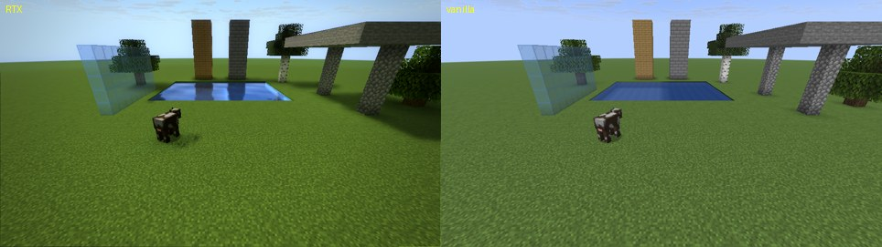
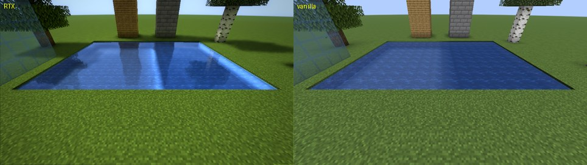
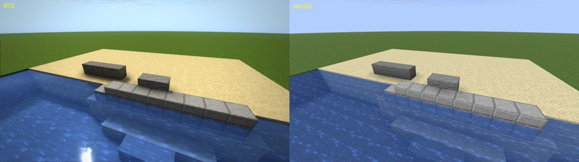
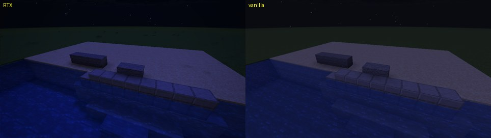
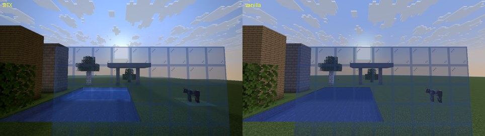
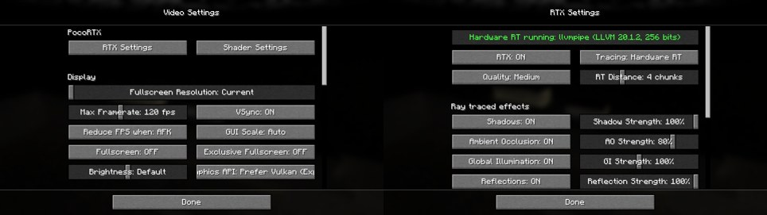

# PocoRTX 2 — аппаратная трассировка лучей для Minecraft Java на телефоне

Fabric-мод, который добавляет в Minecraft Java **настоящую аппаратную трассировку лучей**:
лучи пускаются через Vulkan (`VK_KHR_ray_query`) по структурам ускорения, построенным из
геометрии мира, как в RTX-играх. Сделан для **MJ Launcher** и настроен под
**POCO X8 Pro Max**: его GPU Immortalis-G925 имеет аппаратные блоки трассировки лучей.

Что делает мод:

- **Полноценное RT-освещение.** Освещение мира считается лучами и заменяет ванильное
  целиком: прямой свет солнца и луны (с учётом угла падения и настоящей тени), свет неба
  с затенением, свет блоков и отражённый свет. Стороны блоков, отвёрнутые от солнца,
  темнее, освещённые — ярче; ночью лунный свет голубой, на закате — тёплый.
- **Тени** от солнца и луны, в том числе от объектов за краем экрана, от мобов и предметов;
  мягкие края и тени сквозь листву.
- **Ambient occlusion** — затенение в углах и под объектами.
- **Глобальное освещение** — свет, отражённый от освещённых поверхностей (например,
  зелёный отсвет травы на стенах), и свечение блоков (лава, светокамень, факелы, фонари),
  один отскок.
- **Отражения** с текстурами на воде (с волнами), стекле, льду, металлических и
  полированных блоках и в лужах во время дождя — включая то, что за краем экрана.
- **Блики** солнца на воде и гладких поверхностях.
- **Объёмный свет** — солнечные лучи в воздухе с настоящими тенями.
- **Эффекты шейдеров** в стиле BSL: тонмаппинг, цветокоррекция, bloom, виньетка, резкость.
  Это собственная реализация, кода BSL в моде нет.

Слева — с RTX, справа — ванильная картинка:

| | |
|---|---|
|  |  |
|  |  |
|  |  |

## Какой файл скачать

Готовые `.jar` лежат в папке [`release/`](release/). Нужен Fabric Loader и Fabric API
той же версии Minecraft.

| Версия Minecraft | Файл | Java | Fabric API |
|---|---|---|---|
| 26.2 | `PocoRTX-2.1.0+mc26.2.jar` | 25 | 0.161.x+26.2 |
| 26.3 | `PocoRTX-2.1.0+mc26.3.jar` | 25 | 0.162.x+26.3 |

Модпак «MJ Launcher Beast» сделан под 26.2, для него подходит `mc26.2`.
Версии 1.20.1 и 1.21.1 больше не поддерживаются: там есть только OpenGL, а аппаратная
трассировка лучей в Minecraft возможна только через Vulkan.

## Что нового в 2.1

- **Исправлены светлые линии** на стыках блоков, вдоль их рёбер и длинные светлые полосы
  в воде (те, что были видны на POCO X8 Pro Max ночью у воды). Причин было три:
  - геометрия для лучей иногда бралась из устаревшей сборки чанка, которую игра уже
    отменила (со старым светом и блоками), — теперь берётся только то, что игра
    действительно показывает;
  - в полночь и полдень направление на луну/солнце лежит точно в плоскостях сетки блоков,
    и лучи тени шли ровно по стыкам граней — теперь лучи распределены по диску светила,
    а соседние грани для лучей слегка перекрываются;
  - размытие и масштабирование результата смешивали освещение соседних граней — теперь
    они учитывают нормаль поверхности, а угол к солнцу считается для каждого пикселя.
- **Полноценное RT-освещение** вместо подкрашивания ванильной картинки (см. выше).
- Отражения на воде без искусственного подъёма лучей, один луч отражения на пиксель —
  ядро отражений стало легче для GPU.
- Отладочный показ «Освещение» — во сколько раз RT-свет отличается от ванильного.

## Установка в MJ Launcher

1. Создайте или выберите профиль с **Fabric** версии 26.2 или 26.3.
2. Положите в папку `mods` этого профиля `PocoRTX-…jar` под вашу версию и **Fabric API**
   той же версии. По желанию — **Mod Menu**.
3. Запустите игру: **Настройки → Настройки видео → Графический API → Vulkan**, затем
   перезапустите игру.
4. **Настройки → Настройки видео → Настройки RTX.** Верхняя строка показывает, работает ли
   аппаратный RT: зелёная «Аппаратный RT работает: …» или жёлтая с причиной.

Если графический API — OpenGL или драйвер GPU не поддерживает ray query, трассировка
лучей не включается, а **эффекты шейдеров** работают всё равно.

## Настройки

В **Настройках видео** сверху две кнопки:

- **Настройки RTX** — режим «Аппаратный RT», качество, дальность RT (2–8 чанков вокруг
  игрока) и каждый эффект: вкл/выкл и сила. Там же «Тени листвы», «Шумоподавление»
  и отладочный показ отдельного эффекта (в отладочном показе эффекты шейдеров
  отключаются, чтобы были видны чистые данные).
- **Настройки шейдеров** — экспозиция, контраст, насыщенность, сочность, тон (теплее /
  холоднее), виньетка, bloom, резкость, тонмаппинг.

| Качество | Разрешение трассировки | Лучей AO | Лучей GI | Шагов объёмного света |
|---|---|---|---|---|
| Низкое | 40% | 1 | 1 | 3 |
| Среднее (по умолчанию) | 50% | 2 | 1 | 6 |
| Высокое | 75% | 2 | 2 + тени в отскоке | 8 |
| Ультра | 100% | 4 | 2 + тени в отскоке | 12 |

Если FPS не хватает: качество «Низкое», дальность RT 2–3 чанка, выключить «Объёмный свет»
и «Тени листвы».

## Команды

| Команда | Что делает |
|---|---|
| `/rtx` | статус, в том числе работает ли аппаратный RT |
| `/rtx on` / `/rtx off` | включить / выключить RTX |
| `/rtx menu` / `/rtx shadermenu` | открыть настройки RTX / шейдеров |
| `/rtx quality low\|medium\|high\|ultra` | качество |
| `/rtx distance 2..8` | дальность RT в чанках |
| `/rtx shadows\|ao\|gi\|reflections\|specular\|volumetric\|puddles\|waves\|shaders true\|false` | отдельные эффекты |
| `/rtx debug off\|ao\|shadows\|gi\|reflections\|volumetric\|lighting` | показать один эффект |
| `/rtx reset` | сбросить настройки |

Клавиши: **F6** — вкл/выкл RTX, **F7** — настройки RTX. Настройки хранятся в
`config/pocortx.json`.

## Как это работает

- Меши чанков, которые игра строит для отрисовки, становятся геометрией для лучей: на
  каждую секцию 16×16×16 строится BLAS, мобы и предметы каждый кадр собираются в отдельный
  BLAS, а вокруг камеры каждый кадр собирается TLAS.
- Три compute-ядра с `rayQueryEXT` трассируют в пониженном разрешении: свет (первичный луч,
  AO, видимость солнца/луны, объёмный свет), отражённый свет (GI и свечение блоков)
  и отражения с бликами. Цвет в местах попадания берётся из атласа текстур блоков,
  свойства материалов — по именам текстур.
- Результат накапливается между кадрами и сглаживается с учётом глубины и нормали.
- При сведении для каждого пикселя экрана считается RT-освещение и ванильное освещение
  (та же формула, что у карты освещения игры, и то же затенение граней), и кадр
  умножается на их отношение — так ванильный свет заменяется трассированным без потери
  чёткости текстур.

Ограничения:

- лучи видят мир только в пределах дальности RT; дальше тени и отражения не считаются;
- текстуры мобов в отражениях не видны, поэтому мобы участвуют только в тенях и AO;
- секции, которые игра ещё не построила (например, за спиной сразу после входа в мир),
  появляются в лучах, как только игра их построит;
- под водой отражения и объёмный свет выключаются.

Если включён шейдерпак Iris, PocoRTX отключается сам.

## Как проверялось

- **В настоящих клиентах 26.2 и 26.3** на Vulkan через Mesa lavapipe — программный Vulkan
  с поддержкой ray query: устройство создаётся с расширениями трассировки, строятся BLAS
  и TLAS, работают все эффекты, экраны настроек и «Улучшенная прозрачность». На OpenGL
  мод не падает: RT честно сообщает, что недоступен, эффекты шейдеров работают.
- Ночной берег со скриншота с телефона воспроизведён в тестовой сцене (блоки у воды,
  плита, ступени под водой, луна в зените): на стыках и рёбрах блоков и в воде нет
  светлых линий, днём и ночью.
- **Под GPU POCO X8 Pro Max**: все шейдеры скомпилированы Arm Mali Offline Compiler
  (драйвер r56p0) под Immortalis-G925. Ядра трассировки идут через аппаратные блоки
  трассировки (`Has slow ray traversal: false`). Эффекты шейдеров для OpenGL проверены
  через настоящий конвертер LTW. Подробности — в
  [`docs/mali-g925-report.md`](docs/mali-g925-report.md).

**На телефоне** версия 2.0 работала: по скриншоту с POCO X8 Pro Max аппаратный RT
включается в MJ Launcher (по нему и найдены светлые линии, исправленные в 2.1). Версия 2.1
проверена в тестовых клиентах и компиляторе Mali, на самом телефоне — ещё нет; FPS здесь
измерить нельзя. Если что-то пойдёт не так, пришлите скриншот, `logs/latest.log` из папки
игры и строку статуса из «Настроек RTX».

## Сборка из исходников

Каждая версия — отдельный Gradle-проект: `mc26.2`, `mc26.3` (JDK 25).

```
cd mc26.2 && ./gradlew build
./gradlew compileRtShaders   # после правки src/main/rtshaders (нужен glslangValidator)
```

Готовый файл появится в `build/libs/`. Задача `runAutotest` запускает клиент с тестовой
сценой (нужен мир `run-autotest/saves/rtxtest`, см. `src/testmod`).
