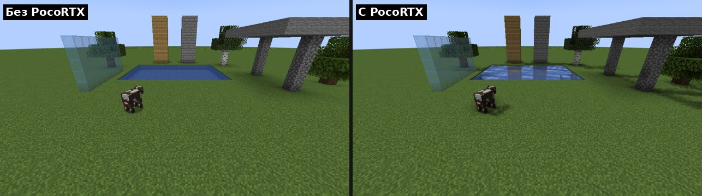
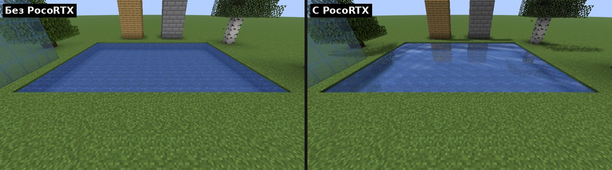
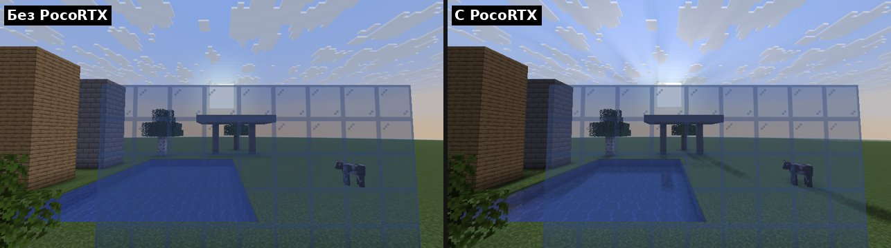
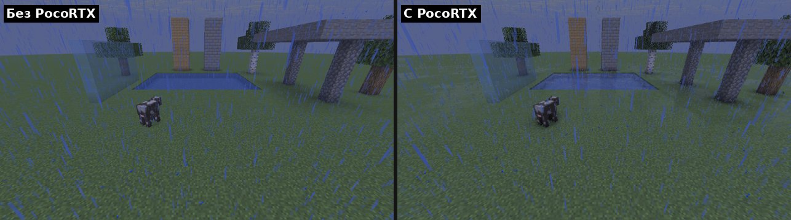

# PocoRTX — трассировка лучей для Minecraft Java на телефоне

Fabric-мод, который добавляет в Minecraft Java эффекты трассировки лучей и работает
поверх обычного рендера игры, без шейдерпаков и Iris. Сделан для **MJ Launcher**
(MojoLauncher и другие лаунчеры на базе PojavLauncher) и настроен под
**POCO X8 Pro Max** (Dimensity 9500s, GPU Immortalis‑G925 MC12).

Что добавляет мод:

- **Тени от солнца и луны** — лучи от каждого пикселя к солнцу; деревья, постройки,
  мобы и игрок отбрасывают тени.
- **Ambient occlusion (AO)** — мягкое затенение в углах, у стен и под объектами.
- **Отражения** на воде (с волнами), на стекле, льду и в лужах во время дождя.
- **Лучи света** (god rays) на рассвете и закате, в том числе сквозь облака.

| | |
|---|---|
|  |  |
|  |  |

## Какой файл скачать

Готовые `.jar` лежат в папке [`release/`](release/). Нужен Fabric Loader и Fabric API
той же версии Minecraft.

| Версия Minecraft | Файл | Java | Fabric API |
|---|---|---|---|
| 1.20.1 | `PocoRTX-1.0.0+mc1.20.1.jar` | 17 | 0.92.x+1.20.1 |
| 1.21.1 | `PocoRTX-1.0.0+mc1.21.1.jar` | 21 | 0.116.x+1.21.1 |
| 26.2 | `PocoRTX-1.0.0+mc26.2.jar` | 25 | 0.161.x+26.2 |
| 26.3 | `PocoRTX-1.0.0+mc26.3.jar` | 25 | 0.162.x+26.3 |

Модпак «MJ Launcher Beast» сделан под 26.2, для него подходит `mc26.2`.
Другие версии Minecraft (1.21.2–1.21.11, 26.1.x) этим модом пока не поддерживаются.

## Установка в MJ Launcher

1. Создайте или выберите профиль с **Fabric** нужной версии.
2. Положите в папку `mods` этого профиля:
   - `PocoRTX-…jar` под вашу версию;
   - **Fabric API** той же версии (обязательно);
   - по желанию **Mod Menu** (кнопка настроек мода) и **Sodium** (больше FPS).
3. Запустите игру и зайдите в мир. В чате можно набрать `/rtx`, чтобы увидеть статус.

### Рендерер и графика

- **1.20.1 и 1.21.1:** рендерер в лаунчере — LTW или MobileGlues. Zink (через Vulkan)
  тоже подходит. Графика в игре — «Детальная» (Fancy); «Быстрая» и «Потрясающая»
  (Fabulous) тоже поддерживаются.
- **26.2 и 26.3:** в настройках видео игры есть выбор графического API. Если лаунчер
  поддерживает Vulkan, можно выбрать его, мод работает и на OpenGL, и на Vulkan.
  «Улучшенная прозрачность» поддерживается.

### Настройки для POCO X8 Pro Max

По умолчанию стоит качество **«Среднее»**: трассировка идёт в половинном разрешении,
это хороший баланс для Immortalis‑G925. Если FPS хватает, попробуйте **«Высокое»**,
если телефон греется или проседает — **«Низкое»**. Масштаб разрешения в лаунчере
тоже сильно влияет на FPS.

| Качество | Разрешение трассировки | AO | Тени | Отражения | Лучи |
|---|---|---|---|---|---|
| Низкое | 50% | 4 луча | 8 шагов | 16 шагов | 12 шагов |
| Среднее | 50% | 6 | 12 | 24 | 16 |
| Высокое | 75% | 8 | 16 | 32 | 24 |
| Ультра | 100% | 12 | 24 | 48 | 32 |

## Управление

На телефоне удобнее всего команды в чате:

| Команда | Что делает |
|---|---|
| `/rtx` | статус и подсказка |
| `/rtx on` / `/rtx off` | включить / выключить |
| `/rtx quality low\|medium\|high\|ultra` | качество |
| `/rtx menu` | открыть экран настроек |
| `/rtx ao\|shadows\|reflections\|shafts\|puddles\|waves true\|false` | отдельные эффекты |
| `/rtx debug off\|ao\|shadows\|reflections\|light_shafts` | показать один эффект отдельно |
| `/rtx reset` | сбросить настройки |

Клавиши: **F6** — вкл/выкл, **F7** — настройки (их можно назначить на кнопки
в редакторе управления лаунчера). С Mod Menu настройки открываются и из списка модов.
Все настройки хранятся в `config/pocortx.json`.

## Как это работает и чего ждать

Это **трассировка лучей в экранном пространстве** (screen-space ray tracing):
лучи идут по буферу глубины того, что видно на экране. Аппаратную RT-трассировку
GPU Minecraft Java на Android использовать не может, поэтому мод работает на любом
рендерере, который тянет обычный Minecraft. Отсюда ограничения:

- тень или отражение пропадает, если объект, который их даёт, за краем экрана;
- отражения показывают только то, что видно на экране; остальное заполняется цветом неба;
- под водой отражения, тени от солнца и лучи света выключаются (AO остаётся).

Если включён шейдерпак Iris, PocoRTX отключается сам, чтобы не конфликтовать.

## Если что-то не работает

- Сообщение **«PocoRTX отключился…»** значит, что текущий рендерер не смог собрать
  шейдеры мода. Игра продолжит работать без эффектов. Смените рендерер в лаунчере
  (LTW ↔ MobileGlues ↔ Zink) или графический API в 26.x и включите мод снова: `/rtx on`.
- Если FPS низкий — `/rtx quality low` и/или меньший масштаб разрешения в лаунчере.
- Если что-то выглядит странно — `/rtx debug shadows` (или `ao`, `reflections`)
  покажет, какой эффект виноват; отключить его можно, например, `/rtx shadows false`.

## Как проверялось

Каждая версия запускалась в настоящем клиенте Minecraft с программным рендерингом
(Mesa llvmpipe и lavapipe): тестовый мод строит сцену с водой, стеклом, колоннами и
деревьями и снимает скриншоты днём, на закате, ночью и в дождь, с эффектами и без.

- **1.20.1 / 1.21.1:** графика «Быстрая», «Детальная» и Fabulous, плюс вместе с Sodium.
  Шейдеры дополнительно проверены как GLSL ES 3.00 (так их видят GL-трансляторы на
  Android) по двум путям: прямой заменой версии и через SPIR-V → ESSL.
- **26.2 / 26.3:** бэкенды OpenGL и Vulkan, классическая и улучшенная прозрачность;
  шейдеры проверены компиляцией в SPIR-V.

На самом POCO X8 Pro Max мод не запускался — если что-то пойдёт не так, пришлите
`logs/latest.log` из папки игры.

## Сборка из исходников

Каждая версия — отдельный Gradle-проект: `mc1.20.1`, `mc1.21.1`, `mc26.2`, `mc26.3`.

```
cd mc1.21.1 && ./gradlew build      # JDK 21; для mc1.20.1 тоже JDK 21
cd mc26.3 && ./gradlew build        # JDK 25 (также mc26.2)
```

Готовый файл появится в `build/libs/`. Задача `runAutotest` запускает клиент с
тестовой сценой (нужен мир `run-autotest/saves/rtxtest`, см. `src/testmod`).
